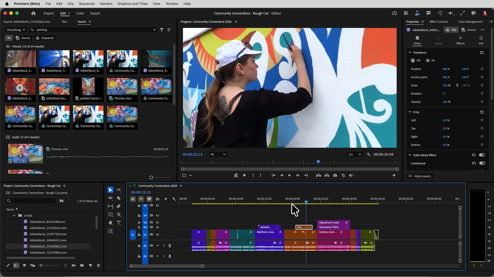

# Creative Cloud for enterprise AI tutorials

Explore tutorials that can help you discover ideas, create content, and streamline creative workflows using AI in Creative Cloud. These tutorials are grouped by role: Graphic Designer, Creative/Art Director, Photoshop Artist/Retoucher, and Video Editor.

## Graphic Designer

<table style="table-layout:fixed">
<tr>
 <td>
   
    

   <a href="turn-flat-vector-art.md"><strong>Turn flat vector art to any angle — without redrawing it</strong></a>
    

    <em>Learn how to use Text to Pattern in Illustrator</em>
     
  </td>
  <td>
   
    

   <a href="seamless-vector.md"><strong>Seamless vector patterns in minutes, not hours</strong></a>
    

    <em>Learn how to build a seamless brand pattern in Illustrator without checking every repeat edge by hand</em>
     
  </td>
  <td>
    
    

     
  </td>
  <td>
    
    

     
  </td>
</tr>
</table>

## Creative/Art Director

<table style="table-layout:fixed">
<tr>
  <td>
   
    

   <a href="one-brief.md"><strong>20 directions from one brief, before lunch</strong></a>
    

    <em>Learn how to turn a creative brief into a shared board of strong visual directions</em>
     
  </td>
  <td>
   
    

   <a href="brief-to-storyboard.md"><strong>From brief to storyboard: Explore video directions before production</strong></a>
    

    <em>Learn how to turn a creative brief into a shared board of strong visual directions</em>
     
  </td>
  <td>
    
    

     
  </td>
  <td>
    
    

     
  </td>
</tr>
</table>

## Photoshop Artist/Retoucher

<table style="table-layout:fixed">
<tr>
  <td>
   
    

   <a href="retouch-faster.md"><strong>Retouch faster and keep your original pixels</strong></a>
    

    <em>Learn how to add natural shadows to a product photo in Photoshop while keeping your original pixels intact</em>
     
  </td>
  <td>
   
    

   <a href="build-presets.md"><strong>Build presets for consistent color across a shoot</strong></a>
    

    <em>Learn how to give a whole photoshoot a consistent look without editing each image one by one</em>
     
  </td>
  <td>
    
    

     
  </td>
  <td>
    
    

     
  </td>
</tr>
</table>

## Video Editor

<table style="table-layout:fixed">
<tr>
  <td>
   
    

   <a href="fill-gaps.md"><strong>Fill gaps in your cut: B-roll, audio, and clips that end too soon</strong></a>
    

    <em>Learn how to use Generative Extend in Premiere</em>
     
  </td>
 <td>
   
    

   <a href="rough-cut.m"><strong>Get to your rough cut faster</strong></a>
    

    <em>Learn how to build a rough cut from interviews and B-roll faster in Premiere, without scrubbing through every clip</em>
     
  </td>
  <td>
    
    

     
  </td>
  <td>
    
    

     
  </td>
</tr>
</table>

