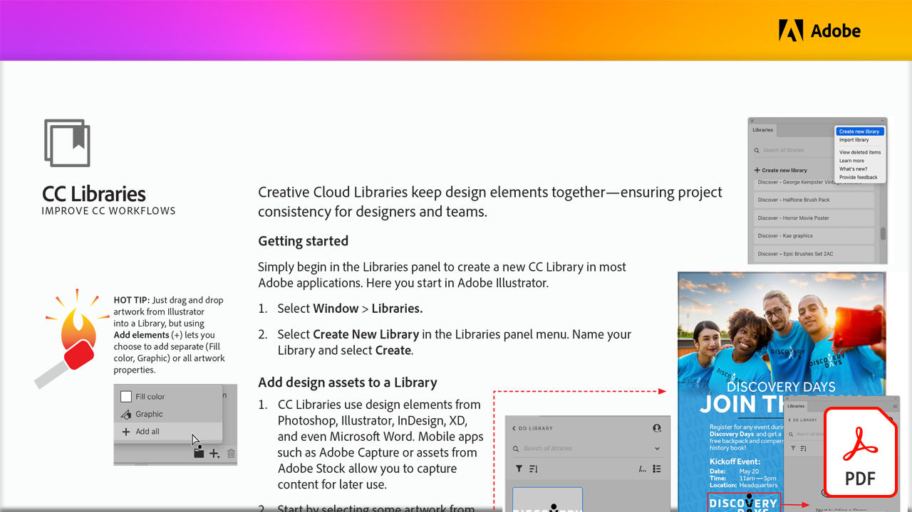

# Improve CC workflows with CC Libraries

Learn how Creative Cloud Libraries keep design elements together—-ensuring project consistency for designers and teams in this hands-on tutorials.

Select the image below to view or download this PDF tutorial.

[{width="680"}](assets/ImproveCCWorkflowsCCLibraries.pdf){target="blank"}
