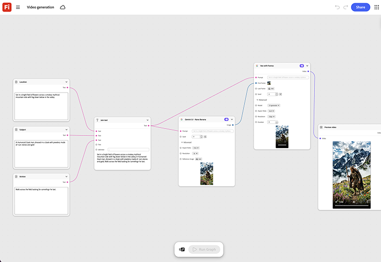

# Getting started - Video generation

Learn how to feed in the approved still key art and a short motion prompt. The template generates a video cut built from that same key art rather than a new shoot. [Open Getting Started - Video generation](https://firefly.adobe.com/graph/edit/id/urn:aaid:sc:US:4729e537-95d5-56a6-b7c4-a1d4dadb76c9).

[!BADGE Industry examples]{type=Informative tooltip="Industry examples"}

* **Finance** - Turn an approved print campaign's key art into a short video for paid social, without scheduling a separate video shoot.
* **Beverages** - Animate a hero product shot into a short teaser for launch day.
* **Retail** - Extend a single campaign photo into a short-form video cut for social.

>[!TIP]
>
>**Before you start** - For the best results customize this template to your own brand, product, and workflow. Swap in your reference images, prompts, and copy before using any output.

{align="center"}

Return to [Get started with Firefly Graph](https://experienceleague.adobe.com/en/docs/creative-cloud-enterprise-learn/cce-learning-hub/fireflyoverview/firefly-graph/overview-firefly-graph).
