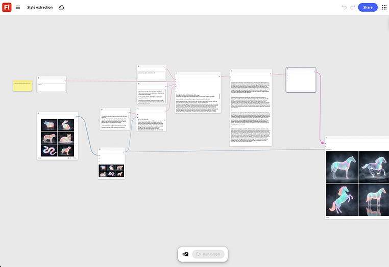

# Style extraction

Learn how to feed in a reference image to extract its color, light, and texture treatment. You can then apply that treatment to any new image run through the same graph. [Open Style extraction template](https://firefly.adobe.com/graph/edit/id/urn:aaid:sc:US:6ab4c3c7-ead2-5fa5-9441-75b7a362ce11).

[!BADGE Industry examples]{type=Informative tooltip="Industry examples"}

* **Travel** - Extract the color and light treatment from an approved hero campaign photo and apply it across twenty new destination images for visual consistency.
* **Retail** - Extract an art director's approved look from one hero shot and apply it to an entire season's product photography.
* **Beverages** - Match new packaging renders to the mood of an award-winning campaign photo.

>[!TIP]
>
>**Before you start** - For the best results customize this template to your own brand, product, and workflow. Swap in your reference images, prompts, and copy before using any output.

{align="center"}

Return to [Get started with Firefly Graph](https://experienceleague.adobe.com/en/docs/creative-cloud-enterprise-learn/cce-learning-hub/fireflyoverview/firefly-graph/overview-firefly-graph).
