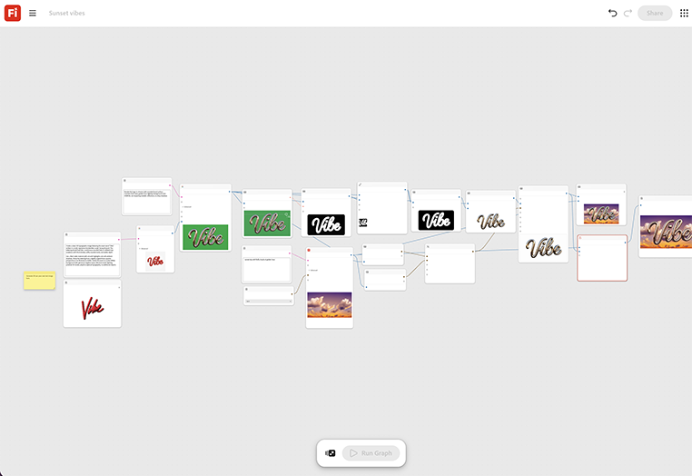

# Sunset vibes

Learn how to create a 3D typographic image featuring the word “Vibe” from a text prompt. [Open Sunset vibes template](https://firefly.adobe.com/graph/edit/id/urn:aaid:sc:US:364c621e-ca81-5a5b-a550-dabed63fb7bc).

[!BADGE Industry examples]{type=Informative tooltip="Industry examples"}

* **Travel** - Overlay a new destination tagline on a stylized sunset background for a social carousel post, built and tested inside one afternoon.
* **Beverages** - Pair a seasonal tagline with a warm lifestyle backdrop for a summer promotion.
* **Retail** - Generate a quick styled text-and-background asset for a flash sale announcement.

>[!TIP]
>
>**Before you start** - For the best results customize this template to your own brand, product, and workflow. Swap in your reference images, prompts, and copy before using any output.

{align="center"}

Return to [Get started with Firefly Graph](https://experienceleague.adobe.com/en/docs/creative-cloud-enterprise-learn/cce-learning-hub/fireflyoverview/firefly-graph/overview-firefly-graph).
