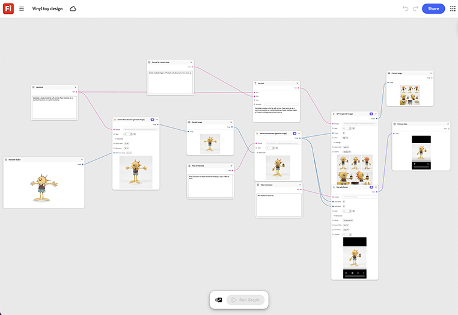

# Vinyl toy design

Learn how to input a character or mascot reference and render it in a stylized vinyl toy form. There are turnaround angles for a licensing or product review deck. [Open Vinyl toy design template](https://firefly.adobe.com/graph/edit/id/urn:aaid:sc:US:6b1e062a-bf16-5dc9-99dd-c3bd4061e238).

[!BADGE Industry examples]{type=Informative tooltip="Industry examples"}

* **Retail** - Design a limited edition collectible tied to a loyalty program launch, reviewed as a concept before committing to a manufacturing run.
* **Beverages** - Mock up a collectible figure of a brand mascot for a limited-run merchandise drop.
* **Entertainment** - Preview a character in vinyl toy form for a licensing pitch deck.

>[!TIP]
>
>**Before you start** - For the best results customize this template to your own brand, product, and workflow. Swap in your reference images, prompts, and copy before using any output.

{align="center"}

Return to [Get started with Firefly Graph](https://experienceleague.adobe.com/en/docs/creative-cloud-enterprise-learn/cce-learning-hub/fireflyoverview/firefly-graph/overview-firefly-graph).
