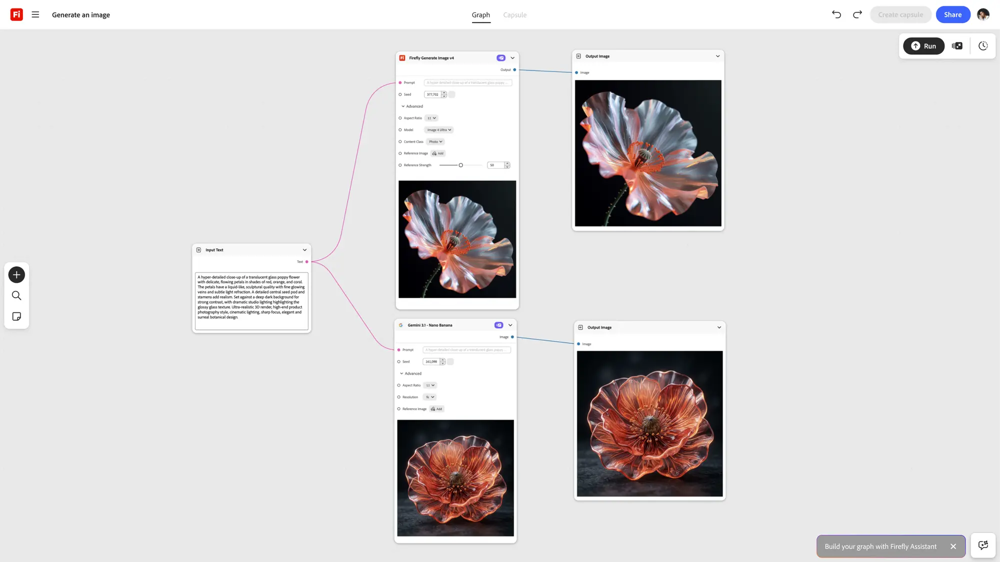

# 1. What is [!DNL Firefly Graph]?

Most generative AI tools give you one output from one prompt. If the brief changes, you rebuild the whole thing by hand, and there's nothing to hand off but the final file.

Firefly Graph works differently. Instead of a single prompt, you build a **graph**: a visual, step-by-step workflow where every input, transformation, and output is captured together. Change one step and rerun it — you don't rebuild the whole chain. Every step is a visible node your team can inspect, adjust, and hand off intact.

{align="center"}

In short, Graph doesn't replace your creative process — it turns that process into something you can see, reuse, and scale.

## Your steps, made visible

Think about a workflow you already run today: start with a brief, gather your inputs, make variations, refine, export. Graph doesn't change those steps — it makes each one visible and reusable:

| Your workflow today | What Graph makes visible |
|---|---|
| Start with a brief | The brief becomes a graph input |
| Gather inputs | Inputs connect directly to nodes |
| Make variations | Variations run in parallel |
| Refine | Refine one node without touching the rest |
| Export | Export straight from the graph |

That's the shift: the same work, but every decision along the way is now something you can see, tweak, and reuse — instead of a black box you'd have to redo from scratch next time.

## Next step

Once you're comfortable with the idea, move on to [2. Key concepts: nodes, connections, and templates](https://experienceleague.adobe.com/en/docs/creative-cloud-enterprise-learn/cce-learning-hub/fireflyoverview/firefly-graph/key-concepts) to learn the vocabulary you'll use to actually build a graph.

Return to [Get started with Firefly Graph](https://experienceleague.adobe.com/en/docs/creative-cloud-enterprise-learn/cce-learning-hub/fireflyoverview/firefly-graph/overview-firefly-graph).
